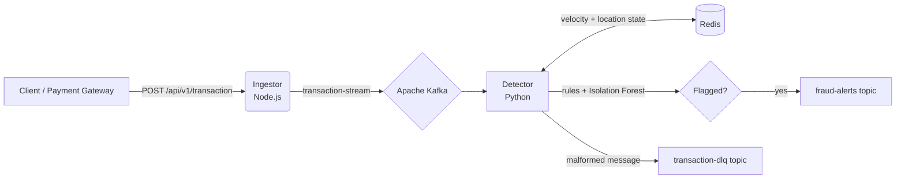

# Sentinel Fraud Engine

**Real-time payment fraud detection built on Kafka, Redis and Python.**

Sentinel screens transactions as they happen, in a service that is separate from the main payment ledger, so fraud checks never slow normal processing. It combines hard rules with an Isolation Forest anomaly model, and keeps working when Redis or Kafka misbehave.


> **Status: working prototype.** The model is trained on simulated data and the system has not been run against real payment traffic. See [Limitations](#limitations).

## Architecture



1. **Ingestor (Node.js, no framework).** Validates the payload and publishes it to Kafka, keyed by `userId` so one user's transactions stay ordered. Returns `202` with a trace ID, `422` for invalid input, `503` if the broker is down.
2. **Detector (Python).** Consumes the stream, looks up per-user velocity and location history in Redis, and decides with three checks:
   - **Velocity rule:** too many transactions from one user inside the window (default 8 per hour).
   - **Amount rule:** a single transaction above a hard ceiling (default 1,000,000).
   - **Isolation Forest:** an anomaly model over amount, velocity and location jump.
3. **Output.** Flagged transactions are published to `fraud-alerts` with the reasons. Messages that cannot be parsed go to `transaction-dlq` so one bad message never blocks the stream.

## Quick start

Requirements: Docker with Compose.

```bash
docker compose up -d --build        # starts Zookeeper, Kafka, Redis, ingestor, detector
python scripts/send_test_transactions.py
docker compose logs -f detector     # watch decisions
docker compose exec kafka kafka-console-consumer \
  --bootstrap-server kafka:29092 --topic fraud-alerts --from-beginning
docker compose down -v              # stop and clean up
```

The demo script sends an ordinary purchase, an over-limit amount, a velocity burst, a large amount combined with a location jump, and an invalid payload.

Example detector output:

```
CLEAN [8f1c...] user=user_123
FRAUD FLAGGED [2b7e...] user=user_456 reasons=AMOUNT_RULE score=-0.643 velocity=1 degraded=False
FRAUD FLAGGED [c40a...] user=user_789 reasons=VELOCITY_RULE score=-0.599 velocity=8 degraded=False
```

## Tests

```bash
make test            # or run each suite on its own:
make test-detector   # python -m unittest, no external services needed
make test-ingestor   # node --test, no npm install needed
```

42 automated tests run with no Kafka or Redis (they use in-memory fakes), and CI runs them on every push.

| Area | What is covered |
|---|---|
| Kafka consumer failures | Errors trigger exponential backoff (1s, 2s, 4s, capped at 30s) and the service recovers and keeps processing; exceptions raised by the client do not crash the loop |
| Redis cache miss | A user with no history is treated as a first transaction; malformed cached values are ignored |
| Redis outage | Scoring continues with neutral velocity, the verdict is marked `degraded`, and the amount rule still works |
| Producer failures | Alert publishing is retried; a persistent failure is counted and logged and does not stop the consumer |
| Bad input | Malformed JSON, wrong types and non-positive amounts go to the dead-letter topic and are committed |
| Simulated load | 600 messages with 15% of Redis calls failing: nothing dropped, every message committed, every injected outlier still flagged |
| Ingestor | Validation rules, `202` / `400` / `413` / `422` / `503` responses, health check, broker failure |

## Evaluation

`detector/evaluate.py` measures the detector on **simulated** transactions: normal behaviour plus three injected anomaly types (large amounts, velocity bursts, and mixed amount / velocity / location jumps). It uses the same decision function as the live service, so the numbers describe the real logic. Averages over 5 random seeds, 20,000 normal and 400 anomalous test transactions per seed:

| Configuration | False-positive rate | Detection rate | Precision |
|---|---|---|---|
| Isolation Forest only | 0.49% | 48.5% | 66.9% |
| Hybrid (model + velocity + amount rules) | 0.93% | 67.4% | 59.3% |

False-positive rate stays below 2% at the default setting. The threshold is a trade-off:

| Contamination setting | Model-only FPR / detection | Hybrid FPR / detection |
|---|---|---|
| 0.5% | 0.11% / 38.0% | 0.55% / 66.5% |
| 1% (default) | 0.48% / 48.5% | 0.93% / 67.4% |
| 2% | 1.41% / 56.8% | 1.85% / 67.7% |
| 5% | 4.04% / 92.7% | 4.05% / 92.7% |

```bash
cd detector && python evaluate.py --seeds 5
```

## Design decisions

- **Hard rules alongside the model.** An Isolation Forest score saturates for values far outside the range it was trained on, so an extreme amount can score no worse than a merely large one. The amount ceiling covers that blind spot, and the velocity rule catches bursts the model sees only weakly.
- **Fail soft on Redis.** If Redis is down the detector keeps scoring with neutral velocity and marks verdicts `degraded` instead of stopping the stream.
- **Commit after processing.** Offsets are committed after a message is handled (at-least-once delivery), and a poison message is dead-lettered rather than retried forever.
- **One decision function.** `sentinel/scoring.py` is used by both the service and `evaluate.py`, so the evaluation cannot drift from production behaviour.

## Limitations

- The demo model trains at startup on **synthetic data**. To use real data, replace `make_training_set()` in `detector/sentinel/synthetic.py`. Evaluation results show the logic behaves sensibly on a controlled stream, not how it performs on real traffic.
- The false-positive rate is largely set by the contamination threshold, so detection rate at that threshold is the more informative number.
- No latency or throughput benchmarks are claimed.
- If alert publishing fails after retries, the alert is logged but not durably stored. A production system would add an outbox.
- The ingestor has no authentication or rate limiting.
- Single-broker Kafka and single Redis instance, for local development only.

## Configuration

Set through environment variables in `docker-compose.yml`.

| Variable | Default | Purpose |
|---|---|---|
| `VELOCITY_RULE` | `8` | Flag at this many transactions per window |
| `VELOCITY_WINDOW_SECONDS` | `3600` | Velocity window |
| `AMOUNT_RULE` | `1000000` | Flag any single transaction at or above this amount |
| `LOCATION_JUMP_SECONDS` | `60` | A location change inside this window counts as a jump |
| `CONTAMINATION` | `0.01` | Isolation Forest outlier threshold |
| `INPUT_TOPIC` / `ALERT_TOPIC` / `DLQ_TOPIC` | `transaction-stream` / `fraud-alerts` / `transaction-dlq` | Kafka topics |
| `MAX_BACKOFF_SECONDS` | `30` | Cap on retry backoff |

## Project layout

```
ingestor/            Node.js HTTP service (validation, Kafka producer) + tests
detector/sentinel/   Python package: velocity tracking, scoring, consume loop
detector/tests/      Unit tests with in-memory Redis and Kafka fakes
detector/evaluate.py Reproducible evaluation on simulated data
scripts/             Demo traffic generator
docker-compose.yml   Local stack
```

## Tech stack

Apache Kafka, Redis, Node.js, Python, Scikit-Learn (Isolation Forest), Docker Compose, GitHub Actions.

---

Built by [Leon Muriithi](https://github.com/leonmuriithi). Licensed under MIT.
